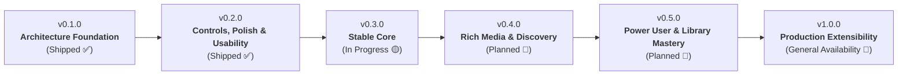

# Lyria Desktop — Version Release Scope & Roadmap

This document defines the release cadence, scope boundaries, and feature deliverables across Lyria's development milestones. Each version groups tightly-coupled capabilities across the Audio Engine, WASM Extension Sandbox, SQLite Data Layer, and SvelteKit Remote Interface.

---

## 🗺️ Release Cadence Overview

---

## 📦 Version 0.1.0 — Architecture Foundation & Extensibility
> **Status:** Shipped ✅  
> **Theme:** Robust foundational architecture: lock-free audio thread, sandboxed WASM extensions, and the infinite core playback loop.

### Deliverables
* **Audio Engine & Concurrency**:
  * Dedicated, non-blocking OS thread for `rodio` audio sink communicating via lock-free `mpsc` channels.
  * Synchronous SQLite isolation funneled through dedicated background database actor channels.
  * Playback position interpolation with throttled IPC updates ($\le$ 4Hz) to prevent bridge saturation.
* **Extism WASM Runtime**:
  * Embedded Extism WebAssembly sandbox with async HTTP (`reqwest`) and quickjs attestation capabilities.
  * Strict memory bounding, execution timeouts, and host logging pipelines.
  * YouTube WASM extension (`WEB_REMIX`) with dynamic BotGuard attestation and PO token minting.
* **Extension System & Import Engine**:
  * Standardized OS application paths (`Lyria/extensions`) with automatic migration from legacy paths.
  * 1-depth subdirectory manifest inspection (`manifest.json` / `extension.json`).
  * Non-blocking archive extraction with Zip Slip protection and safe directory copying via `spawn_blocking`.
  * Remote management UI with solid import dropdown, drag-and-drop overlay (zero layout shift), extension descriptions, and toast notifications.
* **Core Playback Loop**:
  * Dual-mode infinite core loop: Local Markov random walk (offline mode via tag distance and 2-hour recency penalty) and federated WASM radio replenishment (`get_radio`).
  * Autoplay radio toggle (`Local / Remote / Off`).
* **Catalog Exploration & Desktop Integration**:
  * Aggregated Explore feed (spotlights, categories, trending, new releases) and categorized search.
  * Native OS media controls via `souvlaki` (MPRIS on Linux, SMTC on Windows, hardware keys, Now-Playing sync).
  * Unified virtualized collection drawer (`CollectionDetail.svelte`) and real-time Liked Songs telemetry.

---

## 🎯 Version 0.2.0 — Context Controls, Audio Polish & Usability
> **Status:** Shipped ✅  
> **Theme:** Complete primary desktop playback usability with contextual action menus, volume/playback fidelity, and key bug fixes.

### Scope & Deliverables
* **Context Menus & Action Controls**:
  * Global custom right-click context menu across tracks, albums, artists, playlists, and queue.
  * 3-dot options button (`DotsThreeVertical`) on TrackRow, AlbumCard, and QueueSidebar:
    * *Play Next*
    * *Add to Queue*
    * *Add to Playlist* (with sub-menu picker)
    * *Go to Album / Go to Artist*
    * *Toggle Like / Favorite*
    * *Show in File Explorer* (for local tracks)
    * *Remove from Queue* (queue-specific action)
* **Audio Engine Polish**:
  * Gapless playback and configurable crossfade (1–5s) between consecutive tracks.
  * ReplayGain / volume normalization (EBU R128 / LUFS standard) to prevent loudness jumps.
  * Sleep timer (stop playback after N minutes or at the end of the current track).
* **Desktop Polish**:
  * System tray integration with minimize-to-tray, close-to-tray, and playback context menu.
* **Command Palette Expansion**:
  * Extend <kbd>Ctrl+K</kbd> / <kbd>Cmd+K</kbd> `GlobalSearch` with slash commands (`/play`, `/shuffle`, `/liked`, `/queue`, `/clear`).
* **Bug Fixes & Configuration**:
  * Fix duplicate album display when liking/favoriting a local album.
  * Replace hardcoded `'youtube-wasm'` fallbacks with user's configured default provider.

---

## 🔧 Version 0.3.0 — Stable Core
> **Status:** In Progress 🟡  
> **Theme:** Fix all confirmed critical bugs across the audio engine, autoplay core loop, queue state machine, and frontend/backend contract. Every item in this scope is a **code-verified existing defect**. No new features.

### Scope & Deliverables

#### 🔴 P0 — Critical (crashes, data corruption, fatal exceptions)

* [x] **Fix audio hardware disconnect → panic** (Completed in v0.3.0) (`src-tauri/src/audio/mod.rs:86-88`):
  * `OutputStream::try_default().expect(...)` is called once at startup; device removal panics or silently kills the audio thread with no frontend notification.
  * Implement reconnection loop on `OutputStream` failure; emit `device-disconnected` event; transition to `Paused`.
* [x] **Fix Opus multichannel OOB read → audio corruption / crash** (Completed in v0.3.0) (`src-tauri/src/audio/opus_decoder.rs:25, 68-73`):
  * For 5.1/7.1 Opus streams, `decode_float` writes 2-ch output but the de-interleave loop iterates all 6/8 channels, reading uninitialized memory.
  * Implement stereo downmix for all Opus streams with channel count > 2.
* [x] **Fix autoplay provider misattribution → stream failure + 2-track infinite loop** (Completed) (`src-tauri/src/queue/autoplay.rs:58-70`, `src-tauri/src/providers/recommendations.rs:449`):
  * `_pid` is dropped in `compile_federated_radio`; `selected.isrc` is used as `provider_id`, causing `"provider not found"` on stream resolution.
  * Preserve and propagate provider IDs through task results (`TrackResult.provider_id`); add recent-playback queue deduplication to eliminate reciprocal ping-pong loops.
* [x] **Fix `$derived` rune direct mutation → fatal Svelte 5 runtime crash** (BUG-04 - Completed) (`src/lib/stores/audio.svelte.ts:57-58, 358-373`):
  * `setTrackClickBehavior` and `setQueueCompletionBehavior` directly assign to `$derived` fields, throwing `Cannot assign to a derived variable`.
  * Route all setting changes through `settingsStore.setSetting(...)`.
* [x] **Fix JS sandbox `pending_requests` memory leak** (BUG-05 - Completed) (`src-tauri/src/sandbox/sandbox_vm.rs:46-58`):
  * `execute_javascript` inserts `req_id` into `pending_requests` but never removes it on `eval()` error or 15s timeout. Leaks a `oneshot::Sender` per failed cipher call.
  * Add RAII guard or explicit cleanup in all error/timeout branches.
* [x] **Fix track end missing `player-sync` Stopped → player UI stuck at 100% forever** (BUG-06 - Completed) (`src-tauri/src/audio/mod.rs:241-249`, `src/lib/stores/audio.svelte.ts`):
  * Track-end detection emits `track-ended` but never emits `player-sync { state: "Stopped" }`; frontend has no `track-ended` listener.
  * Emit `player-sync` Stopped at queue exhaustion; wire frontend listener accordingly.
* [x] **Fix `block_on` inside Tokio worker → WASM HTTP panics** (Completed in v0.3.0) (`src-tauri/src/providers/wasm_bridge.rs:42-44`):
  * `rt.block_on()` inside `host_http_request` panics when called from a Tokio worker thread.
  * Ensure all WASM host function HTTP calls execute via `spawn_blocking`.

#### 🟠 P1 — High Impact (broken features and silent failures)

* [x] **Fix `collapse_idle` ("Clear Player When Finished") leaving queue intact** (Completed) (`src/lib/stores/audio.svelte.ts:127-140`):
  * When `queueCompletionBehavior == "collapse_idle"`, the `Stopped` handler resets `currentTrack` and timestamps to zero, but never calls `clearQueue()`.
  * Extracted dedicated `handleQueueCompletion()` and call `this.clearQueue()` when `collapse_idle` triggers on track/queue finish.
* [x] **Fix OS hardware media keys completely unresponsive** (Completed) (`src-tauri/src/audio/media_controls.rs:59-67`, `src/lib/stores/audio.svelte.ts:190-198`):
  * `media_controls.rs` emits `"media-play-pause"`, `"media-next"`, `"media-prev"` — zero listeners exist in the Svelte frontend. Claimed feature since v0.1.0.
  * Wire listeners in `AudioStore` to `togglePlay()`, `skipForward()`, `skipBackward()`, and clean up unlisteners in `destroy()`.
* **Fix `.opus` files excluded from local library scanner** (`src-tauri/src/lib.rs:990`):
  * Extension filter `mp3 | flac | wav | m4a | ogg` omits `opus` despite first-class decoder support. One-line fix.
* **Fix in-flight seek vs. track load race condition** (`src-tauri/src/audio/mod.rs`):
  * `AudioCommand::Load` does not increment `seek_generation`; a stale seek result can be applied to a newly loaded track.
  * Increment `seek_generation` inside the `Load` arm.
* **Fix gapless queue destruction on seek** (`src-tauri/src/audio/mod.rs:426`, `src/lib/stores/audio.svelte.ts:307-319`):
  * `AudioCommand::Seek` calls `queued_tracks.clear()`, destroying the pre-buffered next track; `AudioStore.seek()` never re-triggers `queueNextAudio()`.
  * Preserve queue metadata across seek; call `queueNextAudio()` post-seek in the frontend.
* **Fix remote stream HTTP fetch blocking audio thread without timeout** (`src-tauri/src/audio/symphonia_source.rs:137-164`):
  * `runtime_handle.block_on(HttpStream::new(...))` has no connect/read timeout, permanently deadlocking the audio thread on a stalled CDN.
  * Wrap with `tokio::time::timeout`.
* **Fix `RepeatMode::One` only loops at queue terminus, not mid-queue** (`src-tauri/src/queue/mod.rs:333-344, 220-231`):
  * `next_normal()` only checks `RepeatMode::One` when `pos >= tracks.len()`; `peek_next()` unconditionally returns `position + 1` in Normal mode, pre-buffering the wrong track into the gapless sink.
  * Evaluate `RepeatMode::One` before incrementing position in both `next_normal()` and `peek_next()`.
* **Fix manual "Next" replaying last track indefinitely on `RepeatMode::Off`** (`src-tauri/src/queue/mod.rs`):
  * At terminus with repeat off, `next()` returns `Ok(None)` but leaves `current_position` unchanged; subsequent `skip_forward` returns the same last track.
* **Fix HLS always picks first (lowest quality) variant from master playlist** (`src-tauri/src/audio/hls.rs:64`):
  * `pl.variants.first()` is used despite the comment stating highest-bandwidth should be selected.
  * Replace with `.iter().max_by_key(|v| v.bandwidth.unwrap_or(0))`.
* **Fix non-fatal decode errors treated as EOF → premature song cutoff** (`src-tauri/src/audio/symphonia_source.rs:299-328`):
  * Any error from `format.next_packet()` triggers `eof_clone = true`, cutting songs on recoverable mid-file packet errors.
  * Distinguish `SymphoniaError::IoError(UnexpectedEof)` from recoverable errors; skip damaged frames.
* [x] **Fix autoplay inner timeout (4000ms) exceeding outer deadline (3500ms)** (Completed) (`src-tauri/src/providers/recommendations.rs:437-438`, `src-tauri/src/queue/autoplay.rs:43-44`):
  * Per-provider tasks (4s) outlive the outer autoplay deadline (3.5s); their results are always discarded.
  * Reduced inner provider timeout to 3000ms.
* **Fix debug log viewer duplicating all buffered logs on open** (`src-tauri/src/logger.rs:173-194`):
  * 2Hz background emitter starts with `last_sent_id = 0`, firing simultaneously with the initial `get_debug_logs` fetch, duplicating all entries in the UI.
  * Track per-client `last_sent_id`; deduplicate by `id` on the frontend.

#### 🟡 P1-Minor — Correctness (trivial, no risk)

* **Reconcile Markov scoring comment vs. implementation** (`src-tauri/src/db/queries.rs:1969`):
  * Comment claims `weight 30`; code awards `score += 15.0`. Update comment to match implementation.

---

## 🌌 Version 0.4.0 — Rich Media, Lyrics & Discovery Depth
> **Status:** Planned 🔵  
> **Theme:** High-fidelity synchronized lyrics, dynamic musical frontier discovery, catalog browsing depth, and database architecture hardening.

### Scope & Deliverables
* **Synchronized & Timed Lyrics System**:
  * Extension lyrics capability (`lyrics`): WASM export hook `get_lyrics`.
  * Real-time scrolling lyrics component with active line spring interpolation and click-to-seek in `<FullScreenPlayer>` and sidebar.
  * Local `.lrc` timestamped file parser and SQLite lyrics caching.
* **Dynamic Adjacent Horizons** (replace static mock tracks):
  * Invert 7-day SQLite listening habits to dynamically pair unlistened musical genres with dominant artist styles.
  * Fetch 3 real, dynamic preview tracks (artwork, duration, IDs) with streaming/local fallbacks instead of hardcoded canonical key strings.
* **Infinite Scroll Pagination**:
  * Consume `continuation_token` returned by providers and browse endpoints.
  * Svelte Virtualizer scroll-boundary prefetching (~300px before edge) for Explore feed and Search results.
* **Audio Fidelity Badges**:
  * Visual format and quality badging (FLAC 24-bit/96kHz, MP3 320kbps, OPUS) on tracks and player bar.
* **Offline Resilience & Network Loss Handling**:
  * Frontend reactive network awareness (`navigator.onLine` / `online` & `offline` window event listeners) with subtle offline status badge in the UI.
  * Local playback fallback on remote stream failure: if a remote track fails to resolve due to network loss, gracefully fall back to local library seed tracks or cached media rather than halting with an unhandled sandbox socket error.
  * Stream rebuffering: in `symphonia_source.rs`, distinguish transient socket read disconnects from true EOF with a short reconnection window (5-10s) before terminating playback.
* **Extension Priorities & Fallbacks**:
  * User-governed extension priority ordering in Settings.
  * Multi-tier fallback resolution chain across extensions if primary provider cannot resolve a stream.
  * Fix WASM capability mismatch: `get_radio` fallback incorrectly called on `get_related`-only extensions.
* **Database Architecture Hardening**:
  * Configure SQLite WAL mode (`PRAGMA journal_mode = WAL`) and `PRAGMA busy_timeout = 5000` on initialization.
  * Enforce single-writer actor architecture: route all `RecommendationCompiler` writes through `db_tx` channel.
  * Migrate heavy library read queries (`search_library`, `get_local_tracks`, explore feeds) to concurrent `open_read_conn` connections.
* **Queue & Library Completeness**:
  * `remove_from_queue` Tauri command and `QueueState::remove_track`.
  * Runtime queue state persistence: connect queue mutations to debounced SQLite snapshots via `queue::recovery`.
  * Library pagination for collections exceeding 500 items.
  * Fix `QueueState::reorder()` ignoring cursor in shuffle mode → cursor jump on unshuffle.
  * Replace unseeded `thread_rng()` in `regenerate_shuffle_order` with deterministic `StdRng::seed_from_u64(seed)`.

---

## 🛠️ Version 0.5.0 — Power User Workflows & Library Mastery
> **Status:** Planned 🔵  
> **Theme:** Specialized playback surfaces, automatic background indexing, and power user desktop integrations.

### Scope & Deliverables
* **Display Modes**:
  * Compact floating mini-player mode (always-on-top picture-in-picture widget with playback controls).
  * Immersive full-screen / cinematic view (ambient canvas background, high-res artwork, synced lyrics).
* **Library Management**:
  * Automatic filesystem watcher for music folders (background auto-indexing of newly added files without manual rescan).
  * Multi-select and batch actions (Shift/Ctrl-click to queue, add to playlist, or delete).
* **Hardware & OS Integrations**:
  * Audio output device selector on the Player Bar & in Settings (DAC, Bluetooth headphones, external speakers with popover selector on PlayerBar right flank).
  * Discord Rich Presence integration (native or extension-driven, showing artwork, track, artist, elapsed time).
* **Branding & Visual Assets**:
  * [x] Custom Lyria application icon generated across all desktop targets (Completed in v0.3.0) (32x32, 64x64, 128x128, 512x512, Windows `.ico`, macOS `.icns`, SVG, and mobile targets).

---

## 🚀 Version 1.0.0 — Production Extensibility & General Availability
> **Status:** Planned 🔵  
> **Theme:** Production stability, advanced DSP audio algorithms, and full extension authoring capabilities.

### Scope & Deliverables
* **Equalizer & DSP**:
  * Native biquad filter DSP engine on the audio thread.
  * Extension equalizer profiles (`equalizer` capability) with customizable frequency bands and curve definitions.
* **Native Download Manager**:
  * Asynchronous background download engine with chunking, retry support, and extension stream resolution.
  * Automatic metadata tagging (ID3, Vorbis, embedded artwork) and automatic indexing into local database.
* **Extension Lifecycle & Scrobbling**:
  * Playback lifecycle hooks (`start`, `pause`, `progress_50`, `complete`) dispatched to extensions.
  * Support for Last.fm, ListenBrainz, and external scrobblers via extension ecosystem.
* **Metadata Scraper Capability**:
  * Extension hooks (`get_artist_info`, `get_album_info`) to render native artist biography and discography inspection sheet.
* **Extension Themes**:
  * Support theme packages with CSS variable overrides and custom color palettes.
* **Release Engineering & Packaging**:
  * Automated signed multi-platform binary releases: Linux (AppImage, deb, rpm), Windows (MSI/exe), macOS (DMG).
